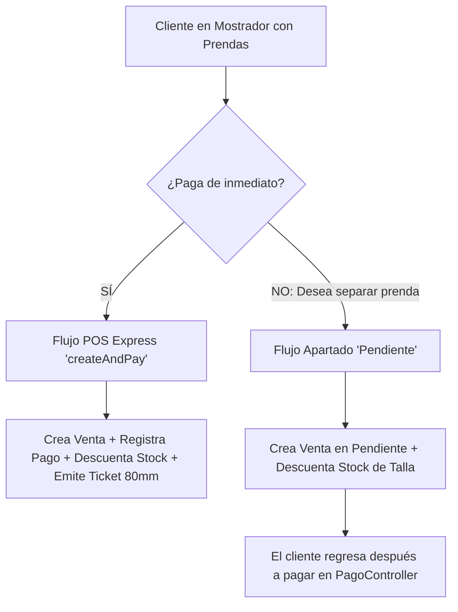

# ⚡ PUNTO DE VENTA (POS EXPRESS) Y APARTADOS

> **Módulo:** Ventas  
> **Métodos Clave:** `VentaService::createAndPay()`, `VentaService::create()`, `VentaController::store()`

---

## 🛍️ 1. DOS MODALIDADES DE VENTA EN TIENDA

Eli Boutique soporta dos flujos de trabajo según la dinámica del mostrador:

---

## ⚡ 2. FLUJO POS EXPRESS (`createAndPay`)

Diseñado para la atención continua de mostrador en tienda de alta rotación.

### Protocolo de Ejecución:
1. El cajero selecciona las prendas y tallas desde el carrito de sesión.
2. Ingresa los datos del cliente (o selecciona cliente mostrador general).
3. Selecciona el comprobante: **Boleta de Venta** o **Factura**.
   * Si es Factura: El sistema exige obligatoriamente RUC de 11 dígitos y Razón Social.
4. Ingresa el `importe` de dinero entregado por el cliente.
5. El sistema calcula en milisegundos:
   $$\text{Vuelto} = \text{Importe Entregado} - \text{Total Venta}$$
   *(Si el importe es menor al total, la validación rechaza la transacción con un mensaje descriptivo).*
6. Dentro de una única transacción atómica `DB::transaction()`:
   * Bloquea pesimistamente las tallas involucradas (`lockForUpdate`).
   * Valida existencias.
   * Crea la venta y sus líneas de detalle.
   * Decrementa el stock por talla y emite la salida en Kardex.
   * Registra el pago en la tabla `pagos`.
   * Incrementa el `ingresoDiario` de la caja abierta y contabiliza el cliente.
7. Redirige al panel con ventana emergente y enlace directo de **auto-impresión de ticket térmico**.

---

## ⏳ 3. FLUJO DE APARTADO O SEPARACIÓN (`Pendiente`)

Permite a los clientes apartar una prenda exclusiva para retirarla posteriormente:
1. La venta se crea con estado `Pendiente`.
2. Las prendas se descuentan del inventario físico para que ningún otro vendedor las ofrezca.
3. La caja del día **no se altera** (no hay ingreso de dinero).
4. El cliente recibe una nota de pedido con el código de venta (ej. `0000105`).
5. Cuando el cliente retorna a liquidar, el cajero busca la venta pendiente y procesa el cobro a través de `PagoController`.
