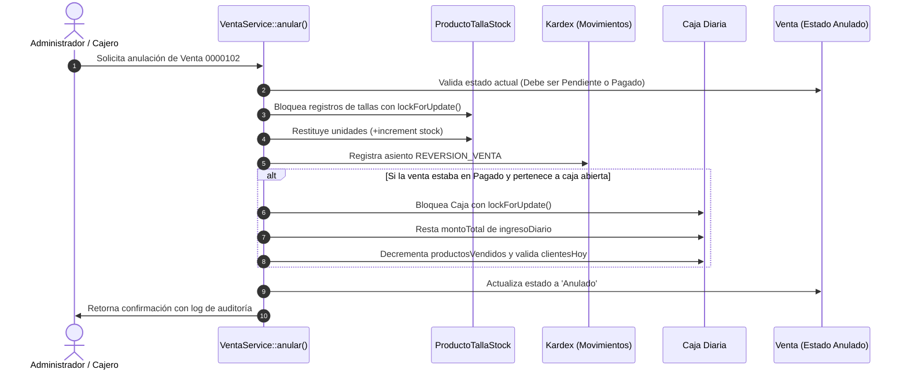

# ↩️ ANULACIONES Y REVERSIONES SEGURAS DE VENTAS

> **Módulo:** Ventas / Caja Diaria / Inventario  
> **Método Maestro:** `App\Services\VentaService::anular()`  
> **Permiso Requerido:** `anular ventas` (Spatie)

---

## 🚫 1. PROHIBICIÓN DE ELIMINACIÓN FÍSICA (`DESTROY`)

En contabilidad empresarial y retail, **el dinero y las operaciones no desaparecen por arte de magia**:
* Queda terminantemente prohibido ejecutar un `DELETE` físico (`destroy`) sobre una venta que ya fue pagada.
* Si un cliente devuelve prendas o una venta fue registrada por error, la única vía válida es la **Anulación Oficial** a través de `VentaService::anular()`.
* La venta permanece en la base de datos con estado `Anulado` para garantizar la auditoría forense y la trazabilidad de comprobantes correlativos.

---

## 🔄 2. PROTOCOLO DE ANULACIÓN PASO A PASO

Cuando un usuario autorizado anula una venta, el sistema ejecuta la siguiente secuencia dentro de `DB::transaction()`:

---

## ⚖️ 3. DIFERENCIACIÓN SEGÚN EL ESTADO INICIAL

### Caso A: La venta estaba en `Pendiente` (Apartado)
1. **Stock:** Las prendas se devuelven de inmediato al inventario disponible.
2. **Kardex:** Se anota la reversión.
3. **Caja Diaria:** **NO se modifica ningún número de la caja**. Como la venta nunca fue cobrada, restar dinero de la caja provocaría un desfalco ficticio en el arqueo del día.

### Caso B: La venta estaba en `Pagado`
1. **Stock:** Se restituye al inventario y al Kardex.
2. **Caja Diaria:** Se descuenta el `montoTotal` del campo `ingresoDiario` y se ajusta la cantidad de productos vendidos.
3. **Cliente del Día:** Si el cliente no realizó ninguna otra compra en la jornada, se decrementa el contador `clientesHoy`.
