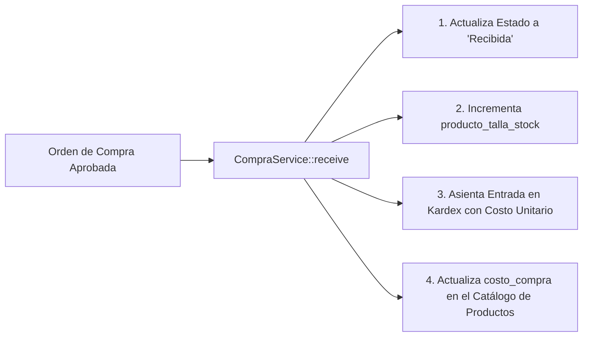

# 📥 RECEPCIÓN DE MERCADERÍA Y VINCULACIÓN AL KARDEX

> **Módulo:** Compras / Inventario  
> **Método:** `App\Services\CompraService::receive()`  
> **Transaccionalidad:** Encapsulado en `DB::transaction()` con bloqueos `lockForUpdate()`

---

## 🏬 1. EL PROCESO DE INGRESO A TIENDA

Cuando el transportista o proveedor entrega las prendas en Eli Boutique, el encargado de tienda procede con la verificación física contra la guía de entrega:
1. Se cuenta cada prenda por talla (ej. 5 blusas talla S, 10 blusas talla M).
2. Se accede al sistema al módulo de Compras y se ubica la orden en estado `Aprobada`.
3. Se presiona la acción **"Recibir Pedido"** (`recibirPedido`).

---

## ⚡ 2. ACCIONES TRANSACCIONALES AL RECIBIR

Al ejecutarse `CompraService::receive()`, el sistema realiza 4 acciones atómicas simultáneas:



### Detalle de las Mutaciones:
1. **Actualización de Stock Real:**
   ```php
   $tallaStock = ProductoTallaStock::where('producto_id', $detalle->producto_id)
       ->where('producto_talla_id', $detalle->producto_talla_id)
       ->lockForUpdate()
       ->first();
   $tallaStock->increment('stock', $detalle->cantidad);
   ```
2. **Generación del Asiento en Kardex (`movimientos_inventario`):**
   * Tipo de movimiento: `INGRESO_COMPRA`.
   * Registra: `stock_anterior`, `cantidad` (+), `stock_nuevo`, `costo_unitario` y referencia al código de orden de compra.
3. **Actualización del Catálogo:**
   * Si la compra contiene un `precio_final` mayor a 0, el campo `costo_compra` del producto se actualiza con este nuevo costo de adquisición. De este modo, las futuras ventas ya conocen el costo real de reposición.
